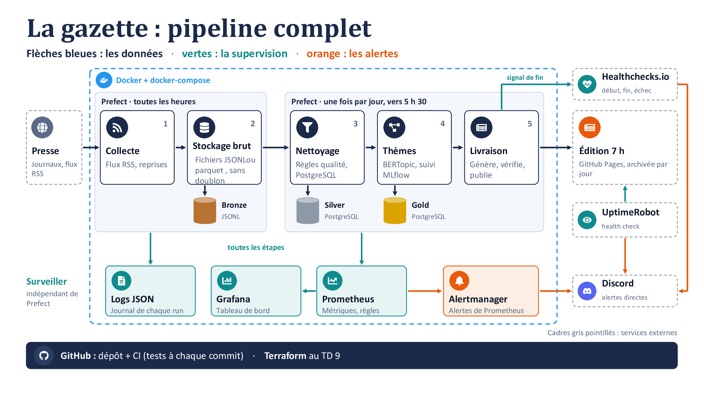

# La gazette - Document de cadrage

Projet M2Ops - M2 Data Engineering & IA - Efrei - 2026-2027 - Groupe M2-DE3
Équipe : Mélissa, Salma, Jason, Amelia - Dépôt Git (privé) : _à compléter_
Version : 1.2 - 20 octobre 2026 (TD 1, après retours de l'enseignant et revue de l'équipe)

---

## 1. Le besoin

Chaque matin, lire la presse quotidienne régionale (PQR) et nationale (PQN) et dire de quoi elle parle. La gazette est un pipeline de données autonome : il collecte ce que publient les journaux, garde ce qui mérite d'être dans une gazette, regroupe les articles par thèmes, contrôle sa propre qualité et livre à 7 h l'édition du jour (thèmes, titres, sources, liens).

C'est un projet d'exploitation (M2Ops), pas de développement. La question n'est pas « est-ce que ça marche sur notre poste ? » mais « est-ce que ça a tourné tous les matins sans personne, et comment le prouve-t-on ? ». La réponse est écrite : métriques, alertes, bulletin quotidien et journal de bord (`docs/journal.md`, tenu à partir du TD 7).

## 2. Périmètre et bornage

| Règle | Conséquence pour le projet |
|---|---|
| Titres, extraits, liens, dates, rubriques uniquement | Aucun article complet, aucune image, aucun commentaire. Les champs `content:encoded` (risque de texte intégral) et les balises d'images sont retirés dès la collecte. |
| Respect de robots.txt et des conditions d'utilisation | Chaque source a été ouverte et vérifiée à la main (flux + robots.txt). Le résultat est consigné dans `sources.csv`. |
| Aucune donnée personnelle | Les champs `author` et `dc:creator` (noms et e-mails de journalistes) sont retirés dès la collecte, y compris du brut. Référence : guide RGPD de l'équipe de développement de la CNIL. |
| Budget zéro | Outils gratuits ou open source, sur nos machines jusqu'à l'infrastructure fournie (TD 4 ou 6). Tout coût éventuel est écrit et justifié. |
| Une édition par jour, à 7 h, de moins de 24 h de fraîcheur | Objectif de service mesuré et affiché en supervision. |
| **Projet de cours, jamais publié** | L'édition est livrée uniquement dans un salon Discord privé (équipe + enseignant). Le dépôt GitHub est privé. Aucune page publique (pas de GitHub Pages, qui est toujours public). |

**Dedans :** collecte RSS, stockage Bronze / Silver / Gold, nettoyage et rapport de qualité, regroupement en thèmes, édition de 7 h, supervision et alertes.
**Dehors :** scraping de pages, texte intégral, résumé par LLM, « beau front », publication publique, comptes utilisateurs, personnalisation.

## 3. Objectifs de service

| Indicateur | Cible | Mesure |
|---|---|---|
| Livraison | L'édition est postée sur Discord à 7 h, tous les jours | Heure de livraison, tracée dans les logs et exposée en métrique |
| Fraîcheur | Tous les articles de l'édition ont moins de 24 h | Âge maximal des articles de l'édition |
| Exhaustivité de la collecte | Aucun article perdu entre deux collectes | Contrôle de chevauchement à chaque collecte (section 6.3) |
| Disponibilité des sources | Au moins un article par source et par 24 h | Nombre d'articles collectés par source |
| Qualité | Taux de doublons et d'articles écartés suivis | Rapport de qualité produit à chaque run |

## 4. Sources

10 sources retenues (5 PQN, 5 PQR), toutes lues par flux RSS 2.0. Détail dans `sources.csv`.

| Statut après vérification | Sources |
|---|---|
| Autorisé sans réserve | Les Échos, La Croix, Sud Ouest, Midi Libre, La Dépêche du Midi |
| Autorisé par robots.txt, avertissements forts | Le Monde, Le Figaro, Libération |
| Interdit par robots.txt (`User-agent: *` / `Disallow: /`) | Ouest-France, Le Télégramme |
| Écartée | La Voix du Nord (flux bloqués par un pare-feu depuis décembre 2025) |

L'usage des sources restrictives est validé par l'enseignant parce que la gazette est un projet de cours qui ne sera jamais publié (section 13). robots.txt n'empêche pas techniquement l'accès, mais l'interdit : ces sources seraient à retirer si la gazette devenait publique.

Pièges repérés en ouvrant les flux : fuseaux horaires différents (`GMT`, `+0000`, `+0200`), paramètres de suivi `utm_*` dans les liens (Ouest-France), même dépêche AFP reprise par plusieurs titres, articles « EN DIRECT » dont le titre change mais pas le lien, extraits absents ou tronqués, contenus hors actualité (programme TV), volumes très différents d'une source à l'autre.

## 5. Architecture

Source du schéma : `docs/architecture.pptx`.

**Le chemin des données :** `sources.csv` → collecte RSS (httpx + feedparser) → **Bronze** (Parquet) → nettoyage et qualité → **Silver** (PostgreSQL) → thèmes (BERTopic) → **Gold** (PostgreSQL) → livraison sur Discord à 7 h.

**Où ça tourne :** tout tourne dans des conteneurs Docker décrits par `docker-compose`, sur nos machines jusqu'au TD 4 ou 6, puis sur l'infrastructure fournie. Seuls Healthchecks.io, UptimeRobot et Discord sont hors de notre infrastructure, volontairement (section 9.4).

**Principe : l'orchestrateur n'est pas le pipeline.** Le code métier est fait de fonctions Python ordinaires, lançables sans Prefect (`python -m gazette.run --date AAAA-MM-JJ`). Prefect n'apporte que la planification, les reprises, l'historique et les logs. Si Prefect tombe, le pipeline peut être relancé à la main ou par le superviseur de relance.

## 6. Données

### 6.1 Fréquence de collecte

Un flux RSS ne garde que ses derniers articles : le lire une seule fois par jour ferait perdre les articles de la veille. La collecte tourne donc en continu, et l'édition une fois par jour sur les articles stockés des dernières 24 h.

La fréquence est fixée par source dans `sources.csv` (colonne `frequence_min`), selon le temps que couvre son flux :

| Source | Mesure à la main (20/10) | Fréquence |
|---|---|---|
| Ouest-France | 10 articles couvrant environ 24 minutes en journée | 10 minutes |
| Les 9 autres | Flux couvrant plusieurs heures (de ~20 articles/jour pour Le Télégramme à ~95 pour La Dépêche) | 60 minutes |

Cela représente environ 360 requêtes par jour au total, réparties sur 10 sites. Les en-têtes `ETag` et `If-Modified-Since` évitent de retélécharger un flux inchangé.

### 6.2 Identifiant et doublons

Chaque article reçoit un `item_id` : l'empreinte SHA-256 de son lien **normalisé** (paramètres de suivi `utm_*` retirés). Le `guid` du flux sert de secours ; il est normalisé de la même façon, car celui d'Ouest-France contient lui aussi des paramètres `utm`.

- **Doublons techniques** (même article relu à chaque collecte) : bloqués à l'écriture du Bronze. Avant d'écrire, la collecte lit les `item_id` déjà présents dans les fichiers Parquet du jour et de la veille, et n'écrit que les articles nouveaux. La collecte peut donc être rejouée sans créer de doublon.
- **Quasi-doublons** (même dépêche AFP dans plusieurs journaux, Midi Libre et La Dépêche du même groupe) : ce ne sont pas des doublons techniques. Ils sont regroupés par les thèmes, ou fusionnés au nettoyage (décision au TD 4).

### 6.3 Contrôle de chevauchement

À chaque collecte, on vérifie qu'au moins un article du flux était déjà connu. Si c'est le cas, les deux collectes se chevauchent et rien n'a été perdu. Le taux de chevauchement par source est exposé en métrique dans Grafana : on prouve, au lieu de supposer, que la collecte est complète.

Deux cas particuliers :
- **Première collecte d'une source** : il n'y a rien à comparer. Le contrôle est sauté et la collecte est marquée « initialisation ».
- **Après une panne** (source ou collecte arrêtée) : l'absence de chevauchement est attendue. On enregistre un **trou de collecte** (source, début, fin, durée) au lieu d'une simple alerte, et il apparaît dans le rapport de qualité et le journal de bord.

Hors de ces deux cas, une collecte sans chevauchement déclenche une alerte et la fréquence de la source est revue.

### 6.4 Stockage : Bronze, Silver, Gold

| Couche | Technologie | Contenu |
|---|---|---|
| **Bronze** (brut) | Fichiers Parquet, un par collecte : `bronze/source=<source>/date=<date>/collecte_<HHMM>.parquet` | Une ligne par article nouveau : colonne `xml_brut` (XML de l'article tel que reçu, champs interdits retirés), `item_id`, source, URL du flux, heure de collecte |
| **Silver** (propre) | PostgreSQL, contrainte d'unicité sur `item_id` | Articles normalisés (titre, extrait, lien, date en UTC, source, rubrique) et filtrés par les règles de qualité |
| **Gold** (prêt à livrer) | PostgreSQL | Thèmes du jour, articles rattachés à chaque thème, éditions livrées et archivées |

Le Bronze n'est jamais modifié : chaque collecte écrit un nouveau fichier, et on peut toujours rejouer le nettoyage. Les ~360 petits fichiers par jour sont regroupés en un seul fichier par source et par jour pendant la nuit (compaction), sans changer leur contenu.

### 6.5 Qualité

Chaque run produit un rapport : articles collectés par source, doublons ignorés, articles écartés par règle, articles conservés, taux de chevauchement, trous de collecte. Les règles (article sans extrait, contenus hors actualité, préfixes « DIRECT » ou « DIAPORAMA », articles en direct…) sont écrites et versionnées dans `docs/qualite.md`.

## 7. Thèmes

BERTopic, directement : embeddings multilingues (sentence-transformers), réduction de dimension (UMAP), regroupement par HDBSCAN, noms des thèmes par mots-clés (c-TF-IDF), sans LLM. Le nombre de sujets varie chaque jour ; HDBSCAN ne fixe pas K et met de côté les articles isolés. Les graines aléatoires sont fixées pour que deux runs sur les mêmes données donnent les mêmes thèmes.

Chaque run est tracé, évalué et versionné avec MLflow (TD 5 et 6), ce qui permet de savoir quelle version du modèle est en service et de revenir en arrière.

## 8. Choix technologiques et alternatives écartées

| Besoin | Choix | Alternatives écartées | Pourquoi pas elles |
|---|---|---|---|
| Lire la presse | Flux RSS | API d'agrégateurs (NewsAPI…) ; scraping HTML | API : quotas gratuits faibles, dépendance à un tiers, PQR mal couverte. Scraping : interdit par le bornage (texte intégral) et fragile. |
| Télécharger les flux | httpx | requests ; aiohttp | requests : pas de délais d'attente fins ni d'HTTP/2. aiohttp : asynchrone uniquement, plus complexe pour 10 flux. |
| Lire le XML des flux | feedparser | lxml ; xml.etree (bibliothèque standard) | Il faudrait gérer à la main les variantes RSS/Atom, les dates mal formées et les flux cassés, que feedparser gère déjà. |
| Orchestration | Prefect | cron ; Dagster ; Airflow | cron : ni reprise, ni historique, une panne passe inaperçue. Dagster : plus riche pour les données mais plus long à apprendre ; Prefect fait aussi les reprises et les notifications. Airflow : trop lourd pour notre volume. |
| Bronze | Fichiers Parquet | JSONL ; PostgreSQL | JSONL : plus fidèle visuellement mais non typé, plus volumineux et plus lent à relire pour le dédoublonnage. PostgreSQL : le brut doit rester un fichier immuable, séparé de la base, pour pouvoir rejouer le nettoyage sans risque de le modifier. Parquet est typé, compressé, partitionnable et validé par l'enseignant. |
| Silver et Gold | PostgreSQL | Fichiers Parquet ; SQLite | Parquet : pas de contrainte d'unicité ni de requêtes concurrentes. SQLite : un seul écrivain à la fois, pas d'accès réseau pour les autres services. |
| Environnement | Docker + docker-compose | Installation locale ; machine virtuelle | Local : « ça marche sur mon poste ». VM : plus lourde et moins portable. |
| CI/CD | GitHub Actions | GitLab CI ; Jenkins | GitLab CI : imposerait de quitter GitHub. Jenkins : un serveur de plus à installer et maintenir. |
| Thèmes | BERTopic | TF-IDF + K-means ; LDA | K-means : impose de fixer le nombre de thèmes, alors qu'il varie chaque jour. LDA : faible sur des textes courts (titre + extrait). |
| Suivi des runs de modèle | MLflow | Weights & Biases ; DVC | W&B : service en ligne, offre gratuite limitée, données hors de chez nous. DVC : versionne les données et modèles, mais pas les métriques et paramètres de chaque run aussi simplement. |
| Métriques et tableaux de bord | Prometheus + Grafana | Zabbix ; stack ELK | Zabbix : orienté supervision de serveurs, moins adapté aux métriques métier. ELK : très gourmand en mémoire, pensé pour les journaux. |
| Métriques d'un flow court | Pushgateway | Exporteur maison permanent ; textfile collector de node_exporter | Prometheus vient chercher les chiffres, mais un flow de quelques minutes est fini avant son passage : le flow dépose ses chiffres dans le Pushgateway. Exporteur maison : un service de plus à écrire. Textfile collector : lié à la machine, moins clair. |
| Alertes fines | Alertmanager | Alertes codées à la main ; Grafana Alerting seul | À la main : ni regroupement, ni répétition, ni routage. Grafana seul : moins adapté à la règle « alerte toujours active » du dead man's switch. |
| Dead man's switch (le vrai watchdog) | Healthchecks.io (offre gratuite) | Uptime Kuma ; Datadog | Uptime Kuma : open source mais devrait tourner sur une autre machine que la nôtre. Datadog : payant. |
| Contrôle de l'extérieur | UptimeRobot (offre gratuite) | Uptime Kuma ; Better Stack | Uptime Kuma : même limite (doit être hors de notre machine). Better Stack : offre gratuite plus restreinte. |
| Canal de livraison et d'alerte | Discord (webhook, salon privé) | E-mail ; WhatsApp | E-mail : configuration SMTP pénible, écarté sur conseil de l'enseignant. WhatsApp : API officielle de Meta (compte vérifié, souvent payante), contraire au budget zéro. Telegram (bot gratuit) est gardé en réserve. |

## 9. Supervision et résilience

### 9.1 La livraison et le bulletin du matin

L'édition est générée par le run de 5 h 30, puis **postée à 7 h 00** dans le salon Discord privé et archivée en Gold. Juste après, le pipeline poste un **bulletin** (infos métier) : heure de livraison, articles collectés par source, articles conservés après nettoyage, nombre de thèmes, sources en échec ou vides, taux de chevauchement, trous de collecte. Ces chiffres sont déposés dans le Pushgateway pour être suivis dans Grafana.

Alertes sur les chiffres (le pipeline tourne mais quelque chose ne va pas) :
- une source à 0 article sur 24 h ;
- une collecte sans chevauchement (hors initialisation et hors trou de collecte déjà enregistré) ;
- un total collecté en baisse de plus de 50 % par rapport à la veille ;
- une édition livrée après 7 h, ou contenant un article de plus de 24 h.

Alertes sur les pannes : une étape Prefect qui échoue après ses reprises envoie un message Discord (hook `on_failure`).

### 9.2 Le superviseur de relance

Processus de contrôle indépendant de Prefect (tâche planifiée dans un conteneur dédié). À heures fixes, il vérifie sans passer par Prefect qu'un run du jour s'est terminé, que l'édition existe et qu'elle est fraîche, et que chaque source a produit au moins un article. En cas d'écart, il alerte. Si l'édition manque à l'heure limite, il relance le pipeline par son point d'entrée Python. Chaque relance est tracée dans le journal de bord. Il tourne sur notre machine : il ne remplace pas le dead man's switch, il le complète.

### 9.3 Le contrôle de l'extérieur

Une page `/health` expose l'état du jour, **sans aucun contenu de presse** (par exemple : « édition du 21/10 : livrée à 7 h 00, 640 articles, 12 thèmes »). UptimeRobot la consulte de l'extérieur toutes les 5 minutes et alerte sur Discord si elle ne répond plus ou signale un échec. Ce contrôle suppose que l'infrastructure fournie expose une adresse joignable ; sinon, il est retiré et Healthchecks.io suffit.

### 9.4 Et si tout tombe en même temps ?

Prefect, le superviseur de relance et la supervision tournent sur la même machine : si elle s'arrête, ils s'arrêtent tous ensemble et aucune alerte interne ne part. Healthchecks.io est volontairement hors de notre machine et sert de **dead man's switch**, le vrai watchdog : c'est l'absence de signal qui déclenche l'alerte. Il reçoit deux signaux :
- le pipeline, **au lancement** du run quotidien (début) et **après la livraison** (fin) ;
- la supervision elle-même, toutes les 15 minutes (règle Alertmanager toujours active), pour prouver qu'elle est vivante.

Si un signal manque, Healthchecks.io prévient l'équipe **directement sur Discord**, sans passer par notre Alertmanager, qui pourrait être tombé avec le reste.

| Ce qui tombe | Qui prévient |
|---|---|
| Prefect seul | Le superviseur de relance (et il relance), puis Healthchecks.io |
| La supervision seule | Healthchecks.io (signal des 15 minutes absent) |
| Toute la machine | Healthchecks.io (aucun signal) et UptimeRobot (`/health` muette) |
| Discord | La livraison et le bulletin n'arrivent pas : l'équipe le remarque ; Healthchecks.io peut notifier Telegram en secours |
| Healthchecks.io | Le bulletin, Grafana et UptimeRobot continuent ; l'absence de signal y est visible |

### 9.5 Calendrier d'une journée

| Heure | Événement |
|---|---|
| En continu | Collecte des flux : toutes les heures, Ouest-France toutes les 10 minutes |
| Chaque nuit | Compaction des fichiers Bronze de la veille |
| 5 h 30 | Prefect lance le run de l'édition (dernière collecte, nettoyage, thèmes, génération) ; signal de début à Healthchecks.io |
| 6 h 15 | Contrôle du superviseur de relance : le run est-il terminé ? |
| 6 h 30 | Heure limite : si l'édition manque, relance directe par le superviseur |
| 7 h 00 | Livraison de l'édition sur Discord ; signal de fin à Healthchecks.io |
| 7 h 05 | Bulletin du matin sur Discord ; second contrôle du superviseur |
| 7 h 15 | Healthchecks.io alerte sur Discord si le signal de fin n'est pas arrivé |

## 10. Infrastructure en code

Tout ce qui tourne est décrit en code, jamais cliqué : environnement de dev en docker-compose (TD 2), ordonnancement (TD 3), déploiement (TD 7), tableaux de bord et alertes (TD 8), infrastructure en code consolidée et reconstruction de zéro (TD 9). La CI (GitHub Actions) teste le code à chaque commit, construit les images Docker et les pousse dans le registre de GitHub. L'outil de déploiement sur l'infrastructure fournie (Ansible pour une machine virtuelle, manifestes Kubernetes pour un cluster, OpenTofu si l'hébergeur a une API) sera choisi quand elle sera connue.

## 11. Risques

| Risque | Impact | Parade |
|---|---|---|
| Publication involontaire (dépôt ou page rendus publics) | Diffusion de titres de sources restrictives | Dépôt privé, livraison uniquement sur Discord privé, page `/health` sans contenu de presse, pas de GitHub Pages |
| Flux RSS indisponible, bloqué ou modifié (cas réel : La Voix du Nord) | Source vide | Reprises, alerte « source à 0 », source de remplacement |
| Flux qui se renouvelle trop vite (cas réel : Ouest-France, 10 articles en 24 min) | Articles perdus entre deux collectes | Fréquence par source, contrôle de chevauchement, trous de collecte enregistrés |
| Conditions qui se durcissent (le robots.txt du Télégramme a été révisé le 15/10/2026) | Source à retirer | Revérification des robots.txt à chaque TD, consignée dans `sources.csv` |
| Sources restrictives (Le Monde, Le Figaro, Libération, Ouest-France, Le Télégramme) | Usage contestable hors projet de cours | Validation de l'enseignant, projet jamais publié, robot identifié honnêtement (User-Agent « LaGazette-Efrei »), lecture du seul flux, jamais des pages d'articles |
| Données personnelles dans les flux (`author`, `dc:creator`) | Non-respect du bornage | Champs retirés avant tout stockage |
| Texte intégral dans `content:encoded` | Non-respect du bornage | Champ retiré avant tout stockage |
| Panne de Prefect | Pas de run | Superviseur de relance indépendant et point d'entrée Python sans Prefect |
| Machine éteinte à l'heure du run | Pas d'édition, pas d'alerte interne | Healthchecks.io et UptimeRobot hors de notre infrastructure, alerte directe sur Discord |
| Thèmes instables d'un jour à l'autre | Édition peu lisible | Graines fixées, runs tracés et versionnés dans MLflow, retour arrière possible |

## 12. Décisions ouvertes

| Sujet | À trancher avant |
|---|---|
| Quasi-doublons : fusion au nettoyage ou regroupement par les thèmes | TD 4 |
| Métriques d'évaluation des thèmes et règles de passage en service d'un nouveau modèle | TD 6 |
| Adresse joignable pour `/health` sur l'infrastructure fournie (sinon UptimeRobot retiré) | TD 7 |
| Outil de déploiement sur l'infrastructure fournie | TD 7 |

## 13. Validations de l'enseignant

| Date | Décision |
|---|---|
| 20/10/2026 | Usage des 10 sources, y compris les sources restrictives, accepté : projet de cours qui ne sera jamais publié |
| 20/10/2026 | Architecture validée ; Bronze en Parquet ; thèmes directement en BERTopic ; alertes sur Discord plutôt que par e-mail |
| 20/10/2026 | Collecte au fil de l'eau (toutes les heures, Ouest-France toutes les 10 minutes), édition une fois par jour |

## 14. Rôles

| Membre | Rôle |
|---|---|
| Mélissa, Salma | Données : collecte, stockage, sources (blocs 1 à 3) |
| Jason, Amelia | Exploitation : thèmes, supervision, infrastructure en code (blocs 4 à 6) |

Un·e responsable d'exploitation est désigné·e chaque semaine d'intersession. Il ou elle lit le bulletin du matin et tient le journal de bord.

## 15. Planning

| TD | Contenu | Compétences |
|---|---|---|
| 1 | Cadrage, sources, schéma (ce document) | C7.1 |
| 2 | Socle : dépôt, conteneurs (dont Prefect), première CI | C7.2, C8.2 |
| 3 | Collecte (script lancé à la main, puis intégré à Prefect) et Bronze | C7.3, C7.1 |
| 4 | Nettoyage, qualité, Silver | C7.3 |
| 5 | Thèmes (MLOps 1) | C7.4 |
| 6 | Évaluation, versionnement, déploiement du modèle (MLOps 2) | C7.4, C7.2 |
| 7 | Livraison de l'édition de 7 h, début du journal de bord | C7.3, C7.2, C7.1 |
| 8 | Surveillance et administration | C8.1 |
| 9 | Infrastructure en code, reconstruction de zéro | C8.2 |
| 10 | Consolidation et soutenance | C7.1 à C8.2 |
